# 🎮 GameHive

A modern game marketplace built with **Next.js 15**, **React 19** and **Tailwind CSS 4**. Browse and filter a game catalogue, read gaming news, manage a wishlist and cart, and check out, all in a polished dark UI with smooth animations.

**🔗 Live demo: [game-hive-sage.vercel.app](https://game-hive-sage.vercel.app)**

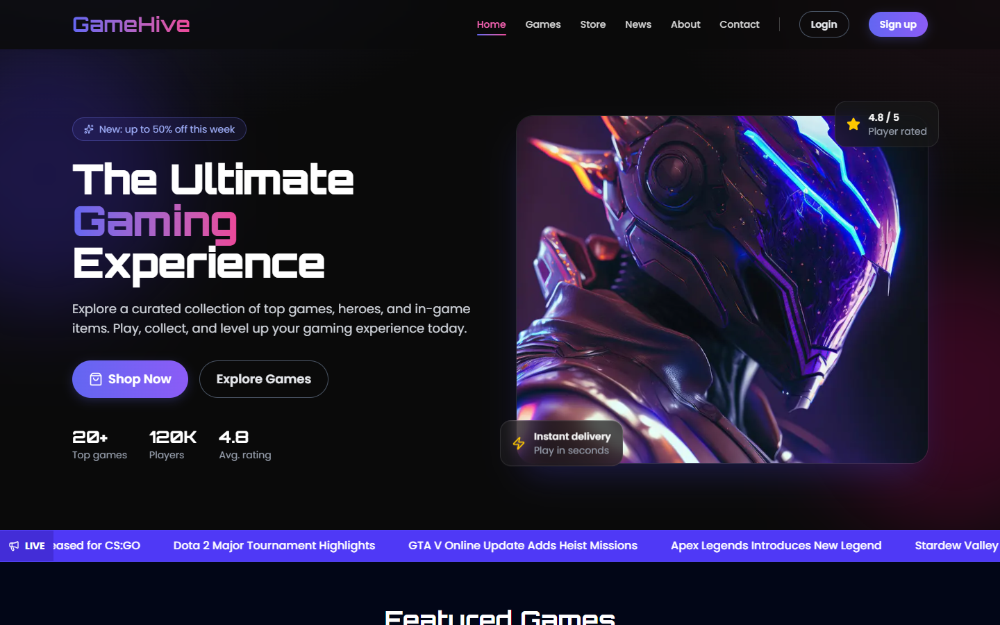

## 🔑 Test account

Cart, wishlist and account pages need a login. Use the built-in test user (also shown on the login page with a one-click *Fill in automatically* button):

| Email | Password |
| --- | --- |
| `demo@gamehive.com` | `Demo1234` |

Checkout is a demo and never charges anything. Use card `4242 4242 4242 4242`, any future expiry (e.g. `12/30`) and any 3-digit CVC. Promo codes: `GAMEHIVE10` (10% off), `WELCOME5` ($5 off over $20), `LEVELUP20` (20% off over $60).

## ✨ Features

- **Catalogue**: 20 games with developer, release date, tags, features and system requirements; related-game suggestions on every detail page.
- **Search & filters**: live search, category chips, price slider, platform filter, six sort options and pagination.
- **Accounts**: sign up / log in with a signed, HTTP-only session cookie, log out, editable profile. Library, wishlist and cart appear only after login; anonymous users who try to add something are sent to login and returned afterwards.
- **Cart & checkout**: quantity limits, promo codes with minimum-spend rules, persisted cart, validated card form (Luhn check, expiry, CVC), purchases land in your Library.
- **News**: 8 articles with categories, authors, read time and a filter.
- **Validation**: shared rules for login, signup (with password-strength meter), contact, profile, newsletter and checkout; the API routes re-validate on the server.
- **Animation & UX**: scroll reveals, count-up stats, hover lifts, animated badges and toasts, skeleton loading, empty states, 404 / error pages. Respects `prefers-reduced-motion`. Responsive down to mobile, keyboard accessible, skip link and ARIA labels.

## 📸 Screenshots

| | |
| --- | --- |
| 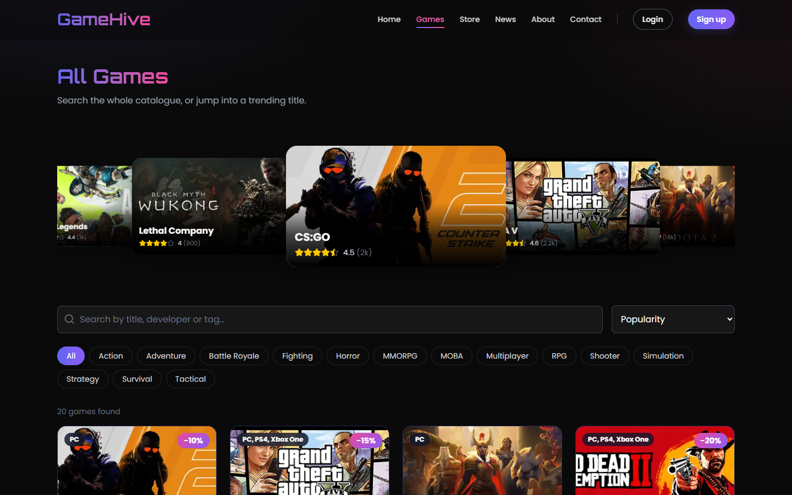 **Games**: search, filter, carousel | 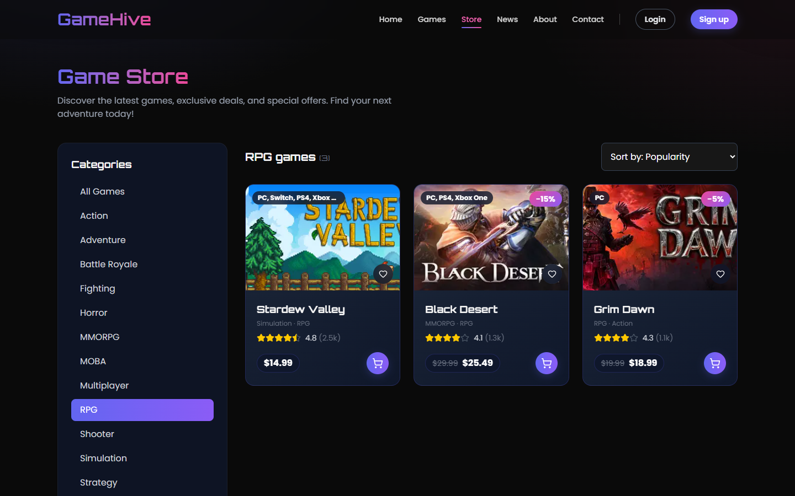 **Store**: sidebar filters, sorting, pagination |
| 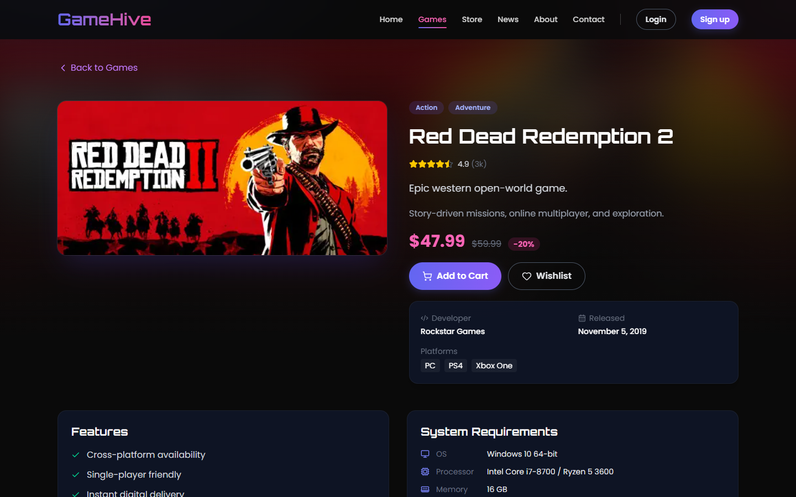 **Game detail** | 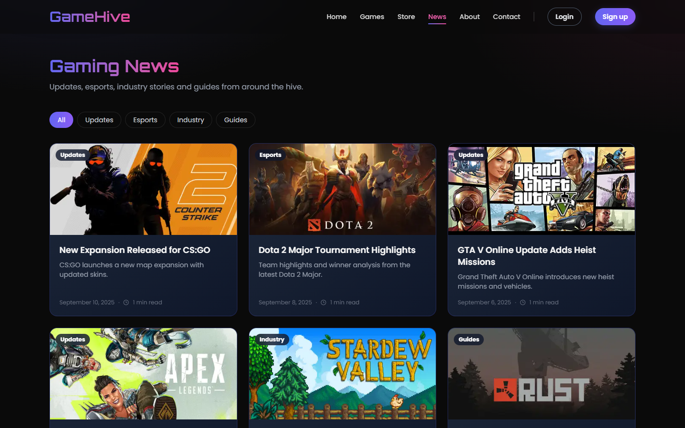 **News** |
| 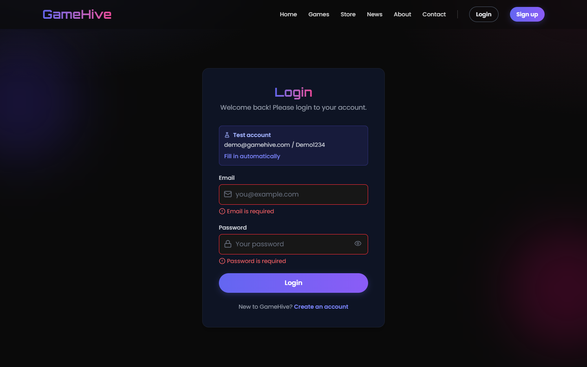 **Login**: validation and test account | 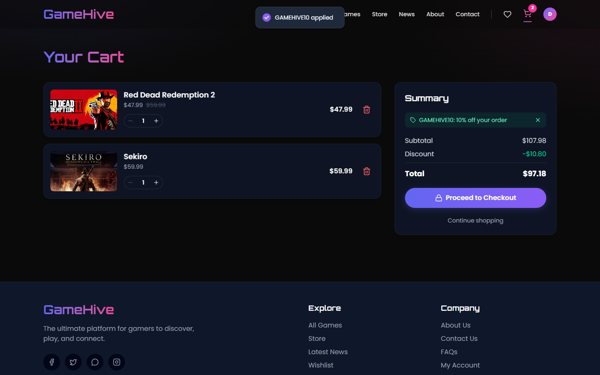 **Cart**: promo code applied |
| 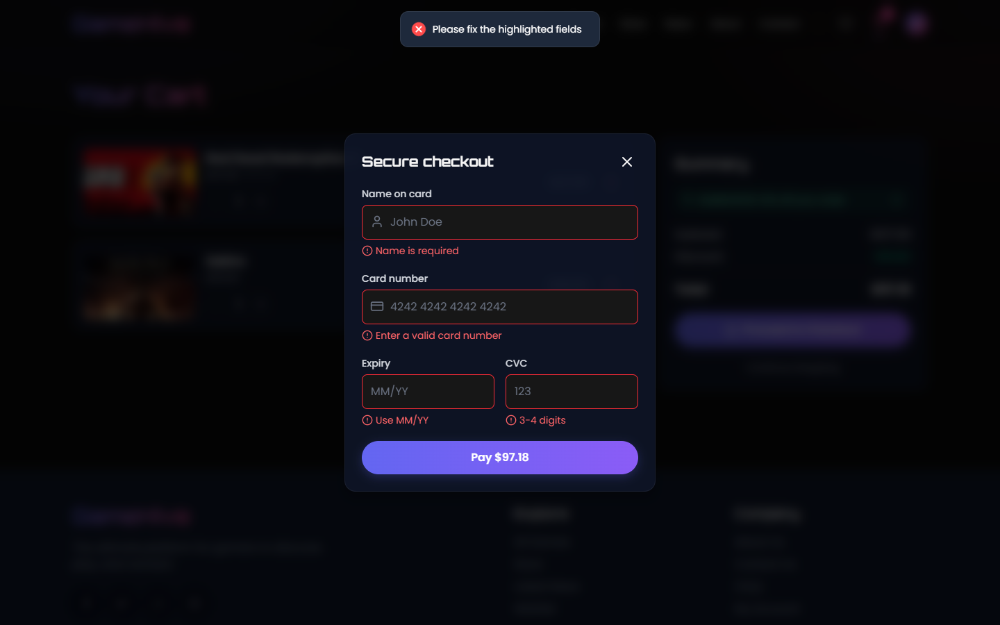 **Checkout**: card validation | 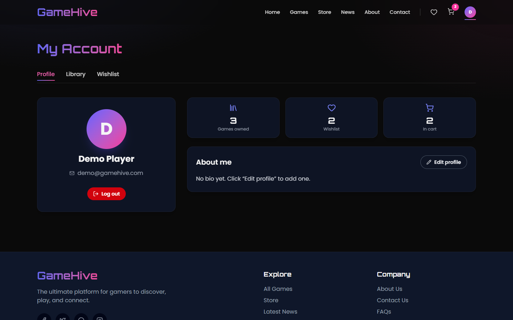 **Profile** |
| 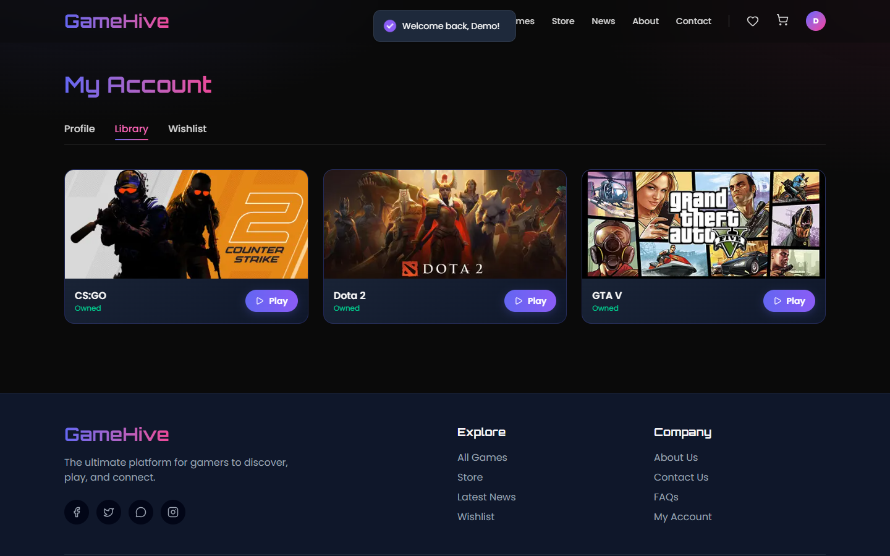 **Library** | 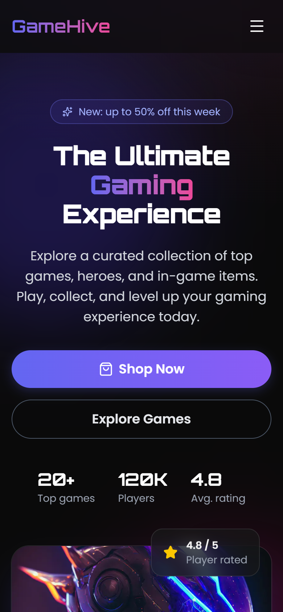 **Mobile** |

<details>
<summary>Full home page</summary>

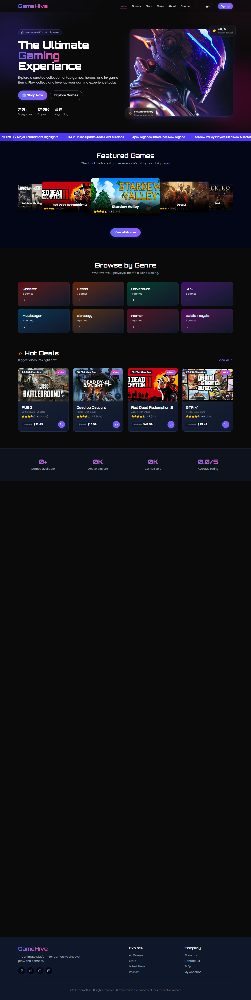

</details>

## 🧱 Tech stack

- [Next.js 15](https://nextjs.org) (App Router, Turbopack) · [React 19](https://react.dev) · TypeScript
- [Tailwind CSS 4](https://tailwindcss.com) with a small component layer in `app/globals.css`
- [Swiper](https://swiperjs.com) carousels · [Lucide](https://lucide.dev) icons · [react-hot-toast](https://react-hot-toast.com)

## 🚀 Getting started

Requires Node.js 18.18+ (20+ recommended).

```bash
git clone <your-repo-url>
cd GameHive
npm install
npm run dev        # http://localhost:3000
```

Other scripts:

```bash
npm run build      # production build
npm start          # serve the production build
npm run lint       # ESLint
```

### Environment variables

| Name | Purpose | Default |
| --- | --- | --- |
| `AUTH_SECRET` | Secret used to sign the session cookie | insecure dev value |

Set `AUTH_SECRET` to a long random string in production (on Vercel: *Project → Settings → Environment Variables*).

## 📁 Project structure

```
app/                 Routes (pages, API routes, layouts)
  api/auth/          login · signup · logout · me
  account/           profile · library · wishlist (login required)
components/          UI grouped by area (auth, games, store, news, home, ui…)
lib/
  data/              games, news, coupons, testimonials, demo user
  providers/         auth, cart and wishlist/library context
  server/session.ts  signed cookie + in-memory user store
  validation.ts      shared form/API validation rules
docs/screenshots/    images used in this README
```

## ⚠️ Demo limitations

This is a portfolio project, not a production store.

- There is no database. Accounts created through **Sign up** live in server memory, so on Vercel (serverless) they can vanish between requests or deploys. The **test account above is hard-coded and always works**.
- Cart, wishlist and library are stored in the browser's `localStorage`.
- Payments are simulated; contact and newsletter forms don't send anything.
- Game artwork is loaded from the Steam CDN and belongs to its respective owners.

## 📄 License

For learning and portfolio use.
